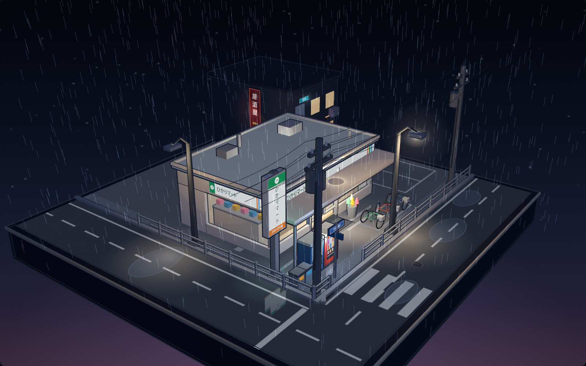

# Rainy Konbini Corner

An interactive rainy-night Japanese convenience-store diorama built with
Three.js and WebGL.



## Live demo

[Open the interactive scene](https://qkkooq.github.io/rainy-konbini-webgl/)

## Features

- Procedural storefront, street furniture, bicycles, road markings, vending
  machine, and utility poles.
- Animated rain, ground ripples, emissive signage, and wet-surface reflections.
- Orbit-style mouse and touch controls with automatic idle rotation.
- Responsive framing for desktop and mobile viewports.
- Reduced-motion support that disables continuous environmental animation.
- No external image textures, analytics, trackers, or runtime CDN dependency.

## Controls

| Action | Control |
|---|---|
| Rotate | Drag with the primary mouse button or one finger |
| Zoom | Mouse wheel or two-finger pinch |
| Pan | Right-drag or Shift-drag |

## Run locally

The page uses an ES module and must be served over HTTP:

```powershell
python -m http.server 8080
```

Then open <http://localhost:8080/>.

## Implementation

The scene is generated at runtime from procedural geometry and canvas textures.
The repository vendors Three.js r160 so the demo does not depend on a CDN.

## License

Original scene code and documentation are available under the MIT License.
Three.js is distributed under its own MIT license; see
[`THIRD_PARTY_NOTICES.md`](THIRD_PARTY_NOTICES.md).

